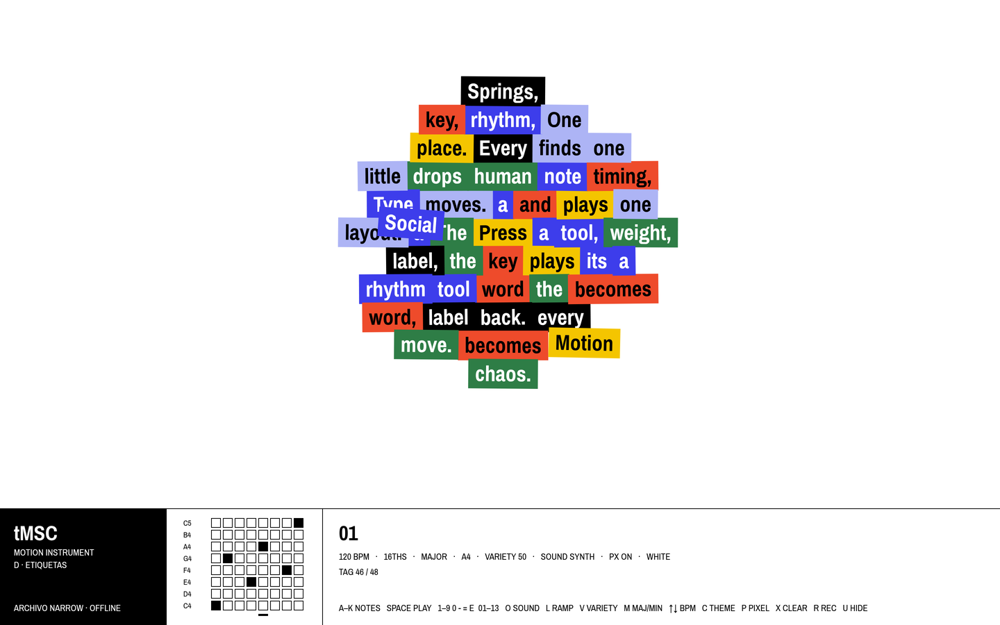

# motion instrument — etiquetas

On the club's site this folder is served at `/motion-instrument`. The bare
path opens the tool. `index.html` is the built file and stays as generated;
`OFL.txt` sits beside it. The demo videos are not in the site repo.

**EN** · **[ES](#es)**

## What it is

A small instrument you play from the keyboard. Each note drops a word-label into a
layout that is packed, collides and springs into place, so typography becomes rhythm.
It comes with its own synth and SFX, 13 numbered layouts and 5 background themes,
and it can record its own canvas. It is a single offline HTML file. The Archivo Narrow
font is embedded, and it makes no network requests and has no dependencies.

Demo: [`media/demo-16x9.mp4`](media/demo-16x9.mp4) · loop: [`media/loop-1x1.mp4`](media/loop-1x1.mp4)

## Run

- Open `index.html` in a desktop browser (Chrome, Edge, Firefox or Safari).
- Or serve the folder with `npx serve .` (or `python3 -m http.server`) and open the URL.
- It works from any sub-path (e.g. `/motion-instrument/` or `/tools/motion-instrument/`)
  because everything is inside `index.html` and no paths are used.
- Sound starts after the first key press (browser autoplay rule).
- `index.html?hero` opens with the interface hidden.

## Controls

The controls float on the canvas as black buttons with a white outline: tempo,
subdivision, preset (numbered 01–13), sound, tone, scale, variety, ramp,
pixel, theme, the step grid, and the text. Tone is how a note sounds — Pluck,
Soft, Reed, Bell — and only one note rings at a time. The text is the
paragraph the notes spell, one word per note. Reset
puts back the original paragraph, which still ends on Motion Social Club
Barcelona. Keyboard shortcuts keep working unless the cursor is in the text
or on a slider.

| Key | Action |
|---|---|
| `SPACE` | play / stop the sequence |
| `A S D F G H J K` | play notes (each note places a word) |
| `1`–`9`, `0`, `-`, `=` | layouts 01–12 |
| `E` | layout 13 |
| `O` | sound: SYNTH → MONO + SFX → SFX + BASS |
| `T` | tone: Pluck → Soft → Reed → Bell |
| `L` | tempo ramp 80 → 160 BPM on / off |
| `V` | variety (0 → 100 % in steps of 25) |
| `M` | major / minor |
| `↑` / `↓` | BPM ±5 (`Shift` = ±1) |
| `C` | background theme |
| `P` | pixel effect on / off |
| `X` | clear the pattern |
| `R` | record the canvas (downloads a `.webm`) |
| `U` | hide / show the interface |

## Credits

Design and code: Esteban González · tMSC — The Motion Social Club.
Font: **Archivo Narrow** by Omnibus-Type, licensed under the SIL Open Font License 1.1
(see [`OFL.txt`](OFL.txt)). The font is embedded in `index.html`.

## License

License: TBD. This covers the code and media; the font is under the OFL (`OFL.txt`).

---

## Qué es

Un pequeño instrumento que se toca con el teclado. Cada nota deja caer una etiqueta-palabra
en una composición que se empaqueta, choca y se asienta con muelles: la tipografía se
convierte en ritmo. Tiene sintetizador y SFX propios, 13 composiciones numeradas y 5 fondos,
y puede grabar su propio canvas. Es un único archivo HTML offline. La fuente Archivo Narrow
va incrustada, y no hace peticiones de red ni tiene dependencias.

Demo: [`media/demo-16x9.mp4`](media/demo-16x9.mp4) · loop: [`media/loop-1x1.mp4`](media/loop-1x1.mp4)

## Cómo usarlo

- Abre `index.html` en un navegador de escritorio.
- O sirve la carpeta con `npx serve .` (o `python3 -m http.server`).
- Funciona desde cualquier sub-ruta (`/motion-instrument/`, `/tools/motion-instrument/`…).
- El sonido empieza tras la primera tecla.
- `index.html?hero` abre sin interfaz.

## Controles

Los mismos controles están en un panel sobre la página. El texto es el párrafo
que las notas deletrean, una palabra por nota. Reset devuelve el párrafo
original. Los atajos siguen funcionando salvo cuando el cursor está en el
texto o en un deslizador.

| Tecla | Acción |
|---|---|
| `ESPACIO` | reproducir / parar |
| `A S D F G H J K` | notas (cada nota coloca una palabra) |
| `1`–`9`, `0`, `-`, `=` | composiciones 01–12 |
| `E` | composición 13 |
| `O` | sonido: SYNTH → MONO + SFX → SFX + BASS |
| `T` | timbre: Pluck → Soft → Reed → Bell |
| `L` | rampa de tempo 80 → 160 BPM |
| `V` | variedad (0 → 100 % en pasos de 25) |
| `M` | mayor / menor |
| `↑` / `↓` | BPM ±5 (`Shift` = ±1) |
| `C` | fondo |
| `P` | efecto píxel |
| `X` | borrar el patrón |
| `R` | grabar el canvas (descarga un `.webm`) |
| `U` | ocultar / mostrar la interfaz |

## Créditos

Diseño y código: Esteban González · tMSC — The Motion Social Club.
Fuente: **Archivo Narrow** (Omnibus-Type), bajo la SIL Open Font License 1.1 (`OFL.txt`).

## Licencia

Licencia: por definir (TBD). La fuente se rige por la OFL.
